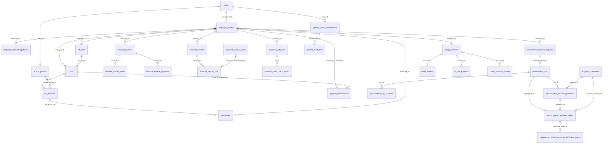

# Company Brain — Database Relationship Map

Generated from the live foreign keys (`information_schema.table_constraints`, 2026-10-31). Only
tables Company Brain reads are drawn. Composite FKs (used by the financial and procurement
migrations to pin child rows to the same `(id, user_id, employer_id)` tuple) are shown once.

## Tenant paths (how every row reaches the organisation)

| Table | Path to `employer_profiles.id` | Company Brain filter |
|---|---|---|
| jobs, job_sites, attendance, payment_transactions, financial_*, procurement_material_requests, procurement_rfqs, procurement_purchase_orders, financial_audit_runs | direct `employer_id` | `.eq("employer_id", org)` |
| job_matches | `job_id → jobs.employer_id` | inner join `jobs!inner(employer_id)` + `.eq("jobs.employer_id", org)` |
| financial_invoice_items / payments | composite FK to invoice + own `employer_id` | `.eq("employer_id", org)` |
| procurement_purchase_order_fulfillment_events | `purchase_order_id → POs.employer_id` | PO ids pre-filtered by org |
| worker_profiles, supplier_companies | shared entities, reachable only through the org's matches / POs | fetched **only** by ids returned from org-filtered rows |
| credit_wallets, ai_usage_events | `account_id → billing_accounts.employer_id` | account resolved from org |
| general_work_* | `user_id` (owner) | `.eq("user_id", owner)` |

## Relationships that do NOT exist (and their consequences)
- `procurement_purchase_orders` ↔ `financial_vendor_bills`: no key → bills and POs for the same
  purchase cannot be matched; Company Brain never adds them together as "expenditure".
- `financial_invoices` ↔ customer master: none (free-text `client_name`).
- `jobs` / `job_matches` ↔ payroll: none; wages are an offered daily cap on `jobs`.
- Any table ↔ department: no department concept.
- Logistics / tender / maintenance: no tables.
